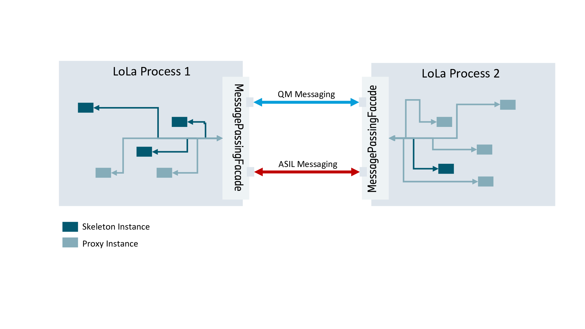

# LoLa Message Passing Service Unit Design

## `lola::MessagePassingFacade` is a Smart Proxy

All messaging interactions between the LoLa proxy/skeleton instances of two different LoLa enabled processes are routed
through their single/per process `lola::MessagePassingFacade` instances:

As such a smart-proxy, the `lola::MessagePassingFacade` will not blindly route messages from proxies/skeletons from one
LoLa process to proxies/skeletons at the other side one-to-one!

Example: If there are two proxy instances within LoLa Process 1, which want to get notified about an update of the very
same event, which is provided by a skeleton instance in LoLa Process 2, then the `lola::MessagePassingFacade` in Process
1 is smart enough, not to send this `RegisterEventNotifierMsg` twice to the `lola::MessagePassingFacade` in Process 2!

**So the general idea is:**
Since we have made the decision, to route the entire message-passing of a LoLa enabled process over one (or two in case
of ASIL) messaging channel to get more flexibility/control over the amount of receiver/listener threads to be used, we
also shall take a further benefit!
That is: This central entity (`lola::MessagePassingFacade`), which cares for the routing, has total overview of the
messaging requirements of its local proxy/skeleton instances and should remove all potential redundancies and thereby
**minimizing the IPC** over `score::mw::com::message_passing` to a bare minimum! Therefore, the notion of **Smart Proxy**.

Technically `lola::MessagePassingFacade` is a combination of a smart proxy and reverse-proxy. But since we have so many
proxies within our `score::mw` implementation, we did not name it as such to avoid further confusion. :)

## Setting up message passing infrastructure

The `score::mw::com::message_passing::Receiver`s used by `lola::MessagePassingFacade` are created/set up during
initialization of our `mw::com` runtime. Depending on the `mw::com` deployment info for the
executable/process, it can be decided, whether only QM (ASIL-QM) or QM and ASIL (ASIL-B) Receivers are needed.

## Event Update Notification

Event Notification is a good showcase for the "smart" behavior of `lola::MessagePassingFacade` as already mentioned (see
example above). Here event notification registrations are aggregated and related messages are only sent once:

## Method Call Dispatch

Method call handlers do not run on the message passing thread. That thread also delivers the replies to method calls
this process makes, so a handler that called another service's method on it waited for itself (issue #767).

- The message passing thread deserializes the call and queues it in the `MethodCallDispatcher`. It does not reply.
- A dispatcher thread runs the handler and then sends the reply through `MethodReply`. `IServerConnection::Reply()`
  may be called from any thread until the connection's disconnect callback, which closes the `ReplyGate`.
- A handler registered with `RegisterAsyncMethodCallHandler` (`RegisterDeferredHandler` on `SkeletonMethod`) gets the
  `MethodReply` and may send it later from any thread.
- `method_call_threads_` handlers run at a time (default 1: one at a time, in arrival order). While a handler waits
  in a method call it made, its slot goes to a spare thread, so a call that comes back into this process is served.
  `method_call_max_threads_` (default 4) bounds the threads; all are created up front.
- `method_call_threads_ = 0` keeps the previous behaviour (handlers on the message passing thread).
- Same-process calls run a synchronous handler on the caller's thread, as before.

| Situation | Caller gets |
|-----------|-------------|
| Queue (`method_call_queue_size_`) full | `kCallQueueFull`, at once |
| Nested call while every thread already waits | `kNoCallThreadLeft`, at once |
| Reply dropped unsent, or skeleton stopped | `kSkeletonAlreadyDestroyed` |
| Caller disconnected before the reply | nothing; the reply is dropped |

Limit: a handler that waits for another thread which makes the call (instead of calling itself) does not lend its
slot. With one thread such a handler cannot be called back; use a deferred handler or more threads.

